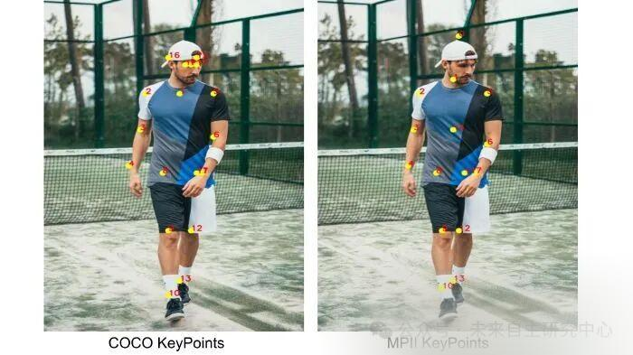
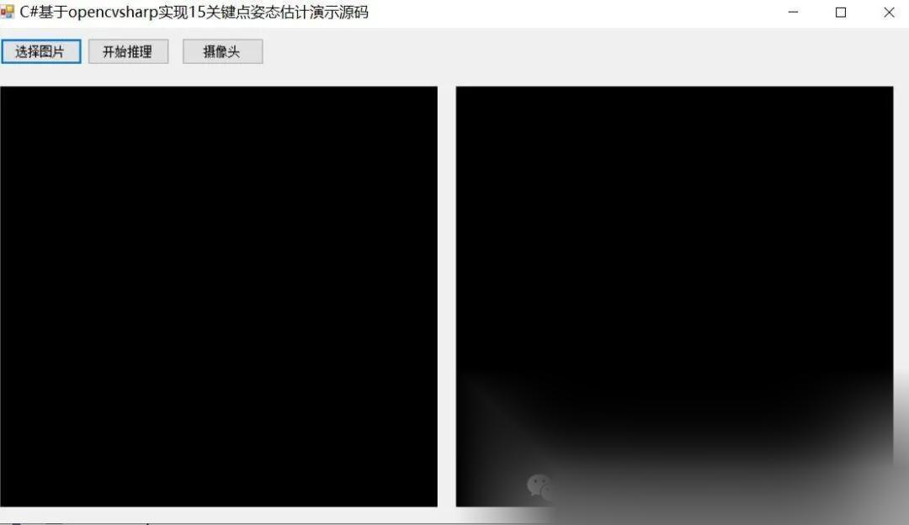
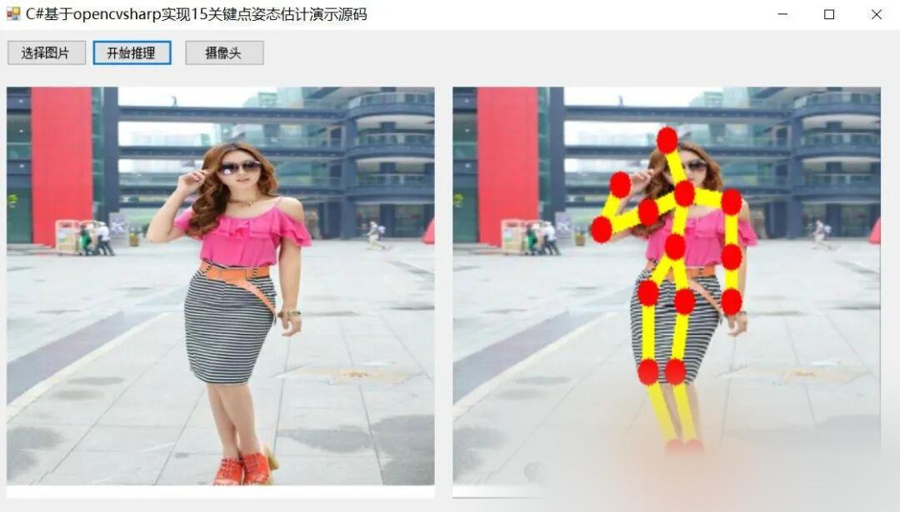
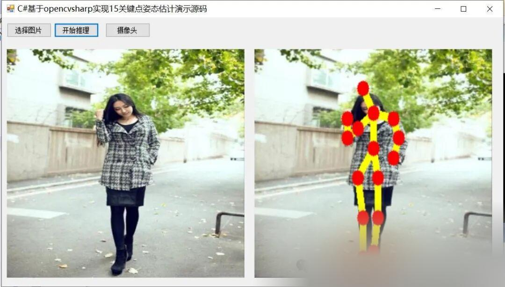
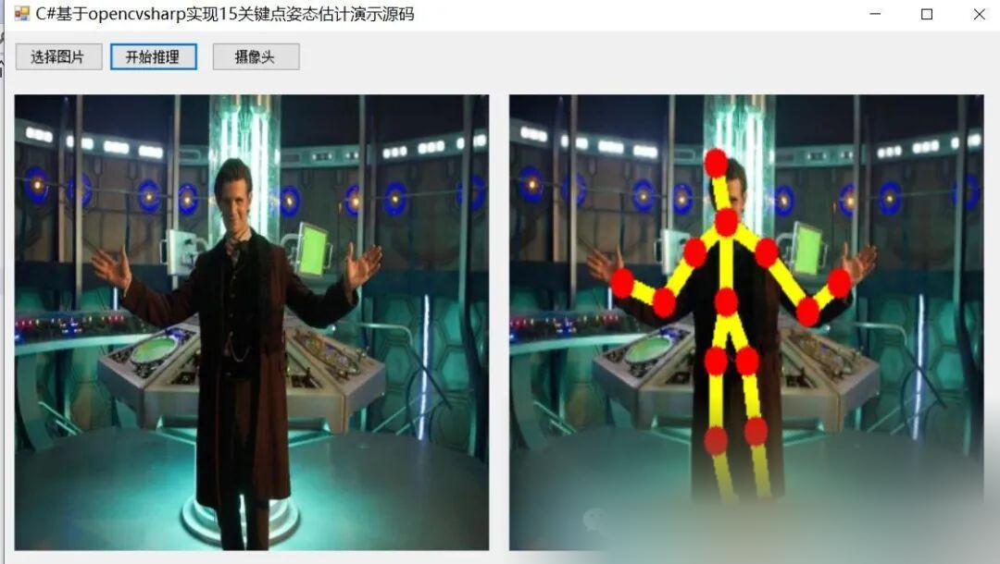

# [C#] Implementing Human Pose Estimation with 15 Keypoints Based on OpenCVSharp

The correct selection of the dataset is also very necessary for having an appropriate impact on the results. In this pose detection, the model has been pre-trained on two different datasets, namely the COCO keypoint dataset and the MPII human pose dataset.

### Dataset

Choosing the appropriate dataset to have a proper impact on the results is also very necessary. In this pose detection, the model was pre-trained on two different datasets, namely COCO keypoints dataset and MPII human pose dataset.

1. COCO: The COCO Keypoints dataset is a multi-person 2D pose estimation dataset, which includes images collected from Flickr. To date, COCO is the largest 2D pose estimation dataset and is considered a benchmark for testing 2D pose estimation algorithms. The COCO model has 18 categories. COCO output format: Nose—0, Neck—1, Right Shoulder—2, Right Elbow—3, Right Wrist—4, Left Shoulder—5, Left Elbow—6, Left Wrist—7, Right Hip—8, Right Knee—9, Right Ankle—10, Left Hip—11, Left Knee—12, Left Ankle—13, Right Eye—14, Left Eye—15, Right Ear—16, Left Ear—17, Background—18

2. MPII: The MPII Human Pose dataset is a multi-person 2D pose estimation dataset comprising nearly 500 different human activities collected from Youtube videos. MPII is the first dataset to include various pose ranges and was also the first dataset to initiate the 2D Pose Estimation Challenge in 2014. The output of the MPII model is 15 points. The output format of the MPII is as follows: head—0, neck—1, right shoulder—2, right elbow—3, right wrist—4, left shoulder—5, left elbow—6, left wrist—7, right hip—8, right knee—9, right ankle—10, left hip—11, left knee—12, left ankle—13, chest—14, background—15.



These points were generated during the processing of the dataset and through comprehensive training with Convolutional Neural Networks (CNN).

The output above shows the athletes' accurate poses at a specific moment. Below is the video analysis result.

[Interface Display]



[Effect Demonstration]







[Partial Implementation Source Code]

```

1.

using System;

1.

using System.Collections.Generic;

1.

using System.ComponentModel;

1.

using System.Data;

1.

using System.Diagnostics;

1.

using System.Drawing;

1.

using System.Linq;

1.

using System.Text;

1.

using System.Threading.Tasks;

1.

using System.Windows.Forms;

1.

using OpenCvSharp;

1.

1.

namespace FIRC

1.

{

1.

public partial class Form1 : Form

1.

{

1.

Mat src = new Mat();

1.

PoseManager detector = new PoseManager(Application.StartupPath+ "\\weights\\pose_deploy_linevec_faster_4_stages.prototxt", Application.StartupPath + "\\weights\\pose_iter_160000.caffemodel");

1.

public Form1()

1.

{

1.

InitializeComponent();

1.

}

1.

1.

private void button1_Click(object sender, EventArgs e)

1.

{

1.

OpenFileDialog openFileDialog = new OpenFileDialog();

1.

openFileDialog.Filter = "Image files (*.*)|*.jpg;*.png;*.jpeg;*.bmp";

1.

openFileDialog.RestoreDirectory = true;

1.

openFileDialog.Multiselect = false;

1.

if (openFileDialog.ShowDialog() == DialogResult.OK)

1.

{

1.

1.

src = Cv2.ImRead(openFileDialog.FileName);

1.

pictureBox1.Image = OpenCvSharp.Extensions.BitmapConverter.ToBitmap(src);

1.

1.

1.

}

1.

1.

1.

}

1.

1.

private void button2_Click(object sender, EventArgs e)

1.

{

1.

if(pictureBox1.Image==null)

1.

{

1.

return;

1.

}

1.

var resultMat = detector.Inference(src);

1.

pictureBox2.Image = OpenCvSharp.Extensions.BitmapConverter.ToBitmap(resultMat); // Mat to Bitmap

1.

}

1.

1.

private void Form1_Load(object sender, EventArgs e)

1.

{

1.

1.

}

1.

1.

private void button3_Click(object sender, EventArgs e)

1.

{

1.

VideoCapture capture = new VideoCapture("test.mp4");

1.

if (!capture.IsOpened())

1.

{

1.

Console.WriteLine("video not open!");

1.

return;

1.

}

1.

Mat frame = new Mat();

1.

var sw = new Stopwatch();

1.

int fps = 0;

1.

while (true)

1.

{

1.

1.

capture.Read(frame);

1.

if (frame.Empty())

1.

{

1.

Console.WriteLine("data is empty!");

1.

break;

1.

}

1.

sw.Start();

1.

var result = detector.Inference(frame);

1.

sw.Stop();

1.

fps = Convert.ToInt32(1 / sw.Elapsed.TotalSeconds);

1.

sw.Reset();

1.

Cv2.PutText(result, "FPS=" + fps, new OpenCvSharp.Point(30, 30), HersheyFonts.HersheyComplex, 1.0, new Scalar(255, 0, 0), 3);

1.

//Display results

1.

Cv2.ImShow("Result", result);

1.

int key = Cv2.WaitKey(10);

1.

if (key == 27)

1.

break;

1.

}

1.

1.

capture.Release();

1.

}

1.

}

1.

}

```

[Video demonstration]

C# WinForm based on OpenCVSharp to implement 15 key points human pose estimation - Bilibili [Test Environment] Visual Studio 2019 .NET Framework 4.7.2 OpenCVSharp 4.8.0 [Demo Source Code Download] [Notes] The source code demonstration only supports single-person pose estimation, does not support multi-person pose estimation from a single image. If you need to support multi-person pose estimation, you can first detect the person and then extract it for individual estimation. For more information, refer to the blog: https://blog.csdn.net/FL1623863129/article/details/140002519, video views: 1, comment count: 0, likes: 0, coins: 0, favorites: 0, shares: 0, author: Future Autonomous Research Center, author's biography: Future Autonomous Research Center, related videos: Python automation scripts, Python training AI to play Honor of Kings automatically, simply stunning! !  !  1. Yolov9+DeepSort+PyQt5 Implementation of Object Tracking Results Demonstration: Encapsulates Yolov5-6.2 into a class with a few lines of code to complete the task of semantic segmentation. Introduction to the encryption and decryption methods for deep learning models based on ONNX. C# OpenCvSharp Yolov8 Face Landmarks for Five-Point Keypoint Detection in Faces, C++ uses pure OpenCV to deploy Yolov8's official OBB rotation box detection. Video demonstration of object tracking using Yolov8+ByteTrack. C++ deployment of Yolov8's ONNX and ByteTrack for object tracking. C# Implements the fastest WinForm target detection currently available for the entire network using Yolov7. C# uses OpenCvSharp for age and gender prediction support video image detectionhttps://www.bilibili.com/video/BV1m1421C7So/? vd_source=989ae2b903ea1b5acebbe2c4c4a635ee

[Test Environment]

vs2019

netframework4.7.2

opencvsharp4.8.0

[Demo Source Code Download]

[Notes]

The source code demonstration supports single-person pose estimation only, and does not support multi-person pose estimation from a single image. If you need to support multi-person pose estimation, you can first detect people, then extract them for individual estimation.


## Payment

Here is a pay link on Stripe ( https://buy.stripe.com/3cs8yP7sY87d0vu9AB ). Please contact me lonlonago@foxmail.com after funding $89, and I will send you a complete data files , thank you!


